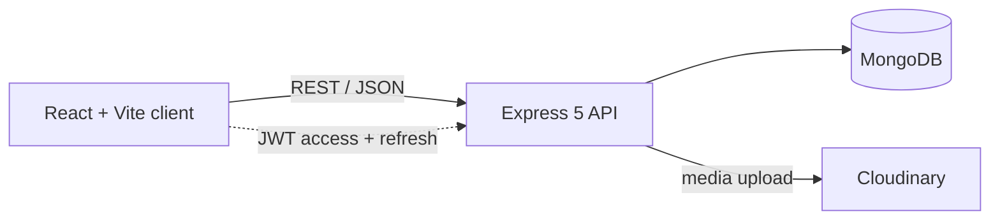

# FrameIT: Private Circles

**A small, private corner of the internet for the people who matter most.**

FrameIT lets families, friends and close teams create invite-only circles where they keep their memories: stories, photos and videos, each filed under the day it actually happened, not just the day it was uploaded. Years later, you can still find "that trip in July 2015" in seconds.

*SEPM project submission. The instructions below run the submitted version as-is.*

---

## Why this exists

Group chats bury memories. Social feeds expose them. Photo albums have no story attached. FrameIT sits in between: a quiet, members-only timeline where every memory has an author, a title, a story and, importantly, **its own date**.

Two ideas drive the design:

1. **Privacy by default.** A circle is invisible to outsiders. The only way in is a short invite code, and only the owner can remove people.
2. **Memories have two dates.** The *memory date* is when something happened (chosen by the author). The *posted date* is when it was shared. You can browse, sort and filter by either.

---

## What you can do

**Circles**
- Create a circle with a name and description; an invite code (`FAM-XXXXXX`) is generated automatically.
- Join with a code. Owners can edit the circle, remove members or delete it. Members can leave at any time.

**Memories**
- Share text, photos or videos, with an optional title and a caption.
- Date each memory when it happened. Future dates are rejected.
- Media is stored on Cloudinary. Text-only memories work without it.
- Authors can delete their own memories, and circle owners can delete any memory in their circle.

**Finding things again**
- **Search** across title, text, author, and even the month, year or date. Typing `july 2015` works. Every word must match somewhere, so searches narrow as you type.
- **Sort** by memory date or posted date, newest or oldest first.
- **Filter** by a date range (inclusive) on whichever date you are sorting by.
- **Paginate** with "Load more" so long timelines stay fast.

**Accounts**
- Passwords are hashed with `bcryptjs`.
- Short-lived JWT access tokens, with refresh tokens that are rotated transparently by an Axios interceptor.
- CORS is locked to your configured origin.

---

## How it fits together



| Layer | Technology |
|---|---|
| Frontend | React 19, Vite 7, Tailwind CSS 4, React Router 7, Axios |
| Backend | Node.js (ES modules), Express 5, Mongoose 8 |
| Database | MongoDB (local or Atlas) |
| Media | Cloudinary, Multer (temporary local buffer) |
| Auth | `jsonwebtoken`, `bcryptjs`, `cookie-parser`, `cors` |

---

## Quick start

### Prerequisites

- Node.js 18 or newer (20 or 22 LTS recommended) and npm 9+
- A MongoDB instance, either local (`mongodb://localhost:27017`) or a MongoDB Atlas URI
- A Cloudinary account, only needed for photo/video uploads

### 1. Configure the backend

```bash
cd backend
cp .env.example .env        # Windows PowerShell: Copy-Item .env.example .env
```

| Variable | Purpose | Example |
|---|---|---|
| `PORT` | API port | `5000` |
| `MONGODB_URI` | MongoDB connection string | `mongodb://localhost:27017/frameit` |
| `CORS_ORIGIN` | Allowed frontend origin | `http://localhost:5173` |
| `ACCESS_TOKEN_SECRET` | Signs access tokens | a long random string |
| `ACCESS_TOKEN_EXPIRY` | Access token lifetime | `1d` |
| `REFRESH_TOKEN_SECRET` | Signs refresh tokens | a different long random string |
| `CLOUDINARY_CLOUD_NAME` | Cloudinary cloud name | `your_cloud_name` |
| `CLOUDINARY_API_KEY` | Cloudinary key | `your_api_key` |
| `CLOUDINARY_API_SECRET` | Cloudinary secret | `your_api_secret` |

> Never commit your real `.env`. Generate secrets with `node -e "console.log(require('crypto').randomBytes(48).toString('hex'))"`.

### 2. Configure the frontend

```bash
cd frontend
cp .env.example .env
```

`VITE_SERVER` should point at the API, by default `http://localhost:5000/api/v1`.

### 3. Run both

```bash
# terminal 1
cd backend && npm install && npm run dev      # http://localhost:5000

# terminal 2
cd frontend && npm install && npm run dev     # http://localhost:5173
```

Opening `http://localhost:5000` should show `FrameIT API is live`. Then visit `http://localhost:5173`.

---

## A two-minute tour

1. **Sign up** at `/auth`.
2. **Create a circle** from the dashboard (for example, "Family Reunion 2026") and copy its invite code.
3. In a private window, sign up as a second user and **join** with that code.
4. Click **Add Story**. Choose text, image or video, give it a title, set **when it happened**, and post.
5. Use the toolbar above the feed to **search**, switch between **memory date** and **date posted**, flip the order, or narrow to a **date range**.
6. As the owner, remove a member or delete the circle. As a member, leave it.

---

## API reference

Base URL: `/api/v1`. All routes except register, login and refresh require a valid access token.

### Users: `/user`

| Method | Endpoint | Description |
|---|---|---|
| POST | `/user/register` | Create an account (multipart, optional `profilePhoto`) |
| POST | `/user/login` | Log in with username or email |
| POST | `/user/refresh-token` | Exchange a refresh token for new tokens |
| POST | `/user/logout` | End the session |
| GET | `/user/me` | Current user |
| GET | `/user/:userId/profile` | Public profile |

### Circles: `/private-group`

| Method | Endpoint | Description |
|---|---|---|
| POST | `/create` | Create a circle (`name`, `description`) |
| POST | `/join` | Join with `inviteCode` |
| POST | `/search` | Search your circles by name |
| GET | `/my` | List your circles |
| GET | `/:groupId` | Circle details and members |
| PATCH | `/:groupId` | Update name/description (owner) |
| DELETE | `/:groupId` | Delete the circle (owner) |
| DELETE | `/:groupId/members` | Remove a member (owner) |
| DELETE | `/:groupId/members/me` | Leave the circle |

### Stories: `/private-group/:groupId/stories`

| Method | Endpoint | Description |
|---|---|---|
| POST | `/` | Add a story. Multipart fields: `contentType`, `text`, optional `title`, `memoryDate` (`YYYY-MM-DD`, not in the future), optional `file` |
| GET | `/` | List stories (see query parameters below) |
| DELETE | `/:storyId` | Delete a story (author or circle owner) |

**Feed query parameters**

| Parameter | Values | Default | Notes |
|---|---|---|---|
| `page`, `limit` | integers | `1`, `10` | `limit` is capped at 50 |
| `q` | text | none | Matches title, text, author, month, year and date; every word must match |
| `sort` | `memory` or `created` | `memory` | Which date to order and filter by |
| `order` | `asc` or `desc` | `desc` | |
| `from`, `to` | `YYYY-MM-DD` | none | Inclusive range on the chosen date |

Responses include `pagination: { total, page, limit, totalPages }`.

---

## Design decisions worth knowing

- **Two dates, one fallback.** `memoryDate` is author-chosen; `createdAt` is automatic. Stories posted before memory dates existed simply fall back to their posted date, so nothing breaks or shows a misleading date.
- **Stories live inside the circle document.** This keeps reads simple and fast for normal circle sizes. Search, sorting and date filtering therefore run in the API process. If circles grow to thousands of stories, the natural next step is a dedicated `stories` collection with database-side indexes.
- **Uploads never touch disk for long.** Multer buffers a file briefly, it is sent to Cloudinary, and the temporary copy is deleted immediately. The temp folder is not served publicly.
- **Invite codes avoid look-alike characters.** No `0/O` or `1/I`, so codes survive being read aloud or typed from a screenshot.

---

## Testing

If your copy includes the integration suite, run it against a configured database:

```bash
cd backend
npm test
```

It exercises registration and login, circle creation and joining, story posting with memory dates, keyword search, permissions, and teardown. For a manual check, follow the tour above.

---

## Project structure

```text
SEPM_PROJECT/
├── backend/
│   └── src/
│       ├── controllers/    privategroup.controller.js, user.controller.js
│       ├── middlewares/    auth.middleware.js, multer.middleware.js
│       ├── models/         privategroup.models.js, user.models.js
│       ├── routes/         privategroup.routes.js, user.routes.js
│       ├── utils/          ApiError, ApiResponse, asyncHandler, cloudinary
│       ├── app.js          Express app and CORS
│       └── index.js        Server and database startup
└── frontend/
    └── src/
        ├── components/PrivateGroup/   Dashboard, CreateGroup, AddStory
        ├── pages/                     Home, Auth, UserProfile, Contact
        ├── utils/                     Axios client, auth context, token storage
        ├── App.jsx, main.jsx, index.css
```

---

## Troubleshooting

| Symptom | Fix |
|---|---|
| Port 5000 or 5173 already in use | Change `PORT` in `backend/.env`, then update `VITE_SERVER` in `frontend/.env` to match |
| MongoDB won't connect | On Atlas, add your IP under Network Access (or allow `0.0.0.0/0` temporarily while testing) |
| CORS errors in the browser | `CORS_ORIGIN` must exactly match the frontend URL and port |
| Photo/video upload fails | Check the Cloudinary values in `backend/.env`; text stories work without them |
| Logged out unexpectedly | Confirm both token secrets are set and the server was restarted after editing `.env` |

---

## Roadmap

- Move stories into their own collection for database-side search and paging
- Audio upload in the interface (the API already accepts audio)
- Story editing, reactions and comments
- Timeline view grouped by year and month
- Email invitations in addition to codes

---

## Team

| Name | Role |
|---|---|
| _Your name_ | _e.g. Full-stack development_ |
| _Teammate_ | _e.g. Backend, testing_ |

Course: SEPM · Institution: _add here_
